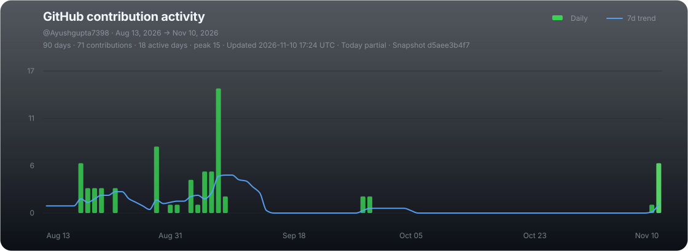

<!-- ===================================================== -->
<!--                    AYUSH GUPTA                        -->
<!--              GREEN NATURE-TECH README                 -->
<!-- ===================================================== -->

<!-- ===================== HEADER ===================== -->

<h3>🌿 Building intelligent solutions for a smarter world.</h3>

  
  
  

  
  

---

<!-- ===================== ABOUT ME ===================== -->

## 👨‍💻 About Me

Hi! I'm **Ayush Gupta**, a 3rd-year B.Tech Computer Science Engineering student passionate about Software Engineering, Artificial Intelligence, and IoT.

I enjoy building practical applications, exploring how systems work internally, and solving real-world problems through technology.

Currently, I'm developing web applications for an AI-based logistics intelligence platform, exploring Machine Learning, and working on IoT-based smart automation solutions.

- 🎓 B.Tech Computer Science Engineering Student
- 💻 Interested in Software Engineering and Problem Solving
- 🤖 Learning Machine Learning and Artificial Intelligence
- 🌐 Developing web applications using React and JavaScript
- 🔌 Exploring IoT and Embedded Systems
- 🚚 Working on collaborative real-world technology projects
- 🎯 Goal: Become a skilled Software Engineer who builds reliable, impactful, and intelligent technology

> 🌱 Learn continuously. Build consistently. Create meaningful impact.

---

<!-- ===================== CURRENT FOCUS ===================== -->

## 🌱 What I'm Currently Working On

<table>
<tr>
<td width="50%">

### 🤖 Machine Learning

Learning ML fundamentals, data preprocessing, model training, and prediction.

</td>
<td width="50%">

### 🌐 Web Development

Building React applications with clean UI/UX and API integration.

</td>
</tr>
<tr>
<td width="50%">

### 🚚 Smart Logistics

Developing the web application for the SIH 2026 NER Logistics Intelligence Platform.

</td>
<td width="50%">

### 🏠 SmartNest

Exploring smart home automation and energy monitoring using IoT.

</td>
</tr>
</table>

---

<!-- ===================== TECH STACK ===================== -->

## 💻 Tech Stack & Tools

### 🧠 Programming Languages

  
  
  
  

### 🌐 Web Development

  
  
  

### 📊 Data Science & Machine Learning

  
  
  
  

### 🗄️ Databases

  
  
  

### 🔌 IoT & Development Tools

  
  
  
  
  

---

<!-- ===================== GITHUB ANALYTICS ===================== -->

<!-- ## 📊 GitHub Analytics -->
<h2 align="center">📊 GitHub Analytics </h2>

 

<!-- ===================== STREAK ===================== -->

 
<h2 align="center">🔥 Contribution Streak </h2>

---

<!-- ===================== CONTRIBUTION GRAPH ===================== -->

<h2 align="center">📈 GitHub Contribution Activity</h2>

  

---

<!-- ===================== CONNECT ===================== -->

## 🤝 Let's Connect

I'm always interested in learning, collaborating on projects, and connecting with people who enjoy building technology.

---

<!--===================== FOOTER =====================-->

### 💚 Thanks for visiting my profile!

**Keep learning. Keep building. Keep growing.**

